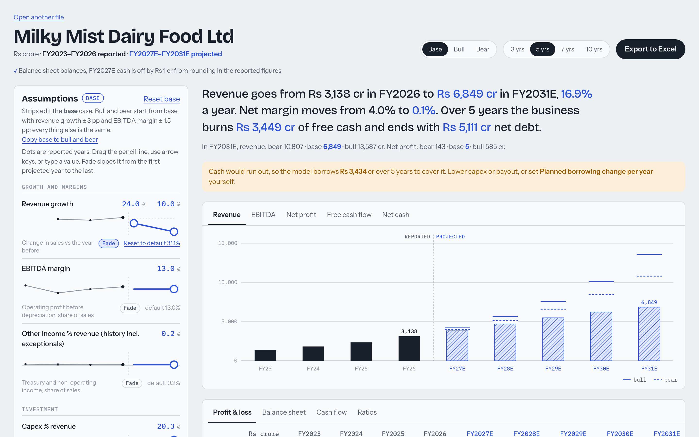
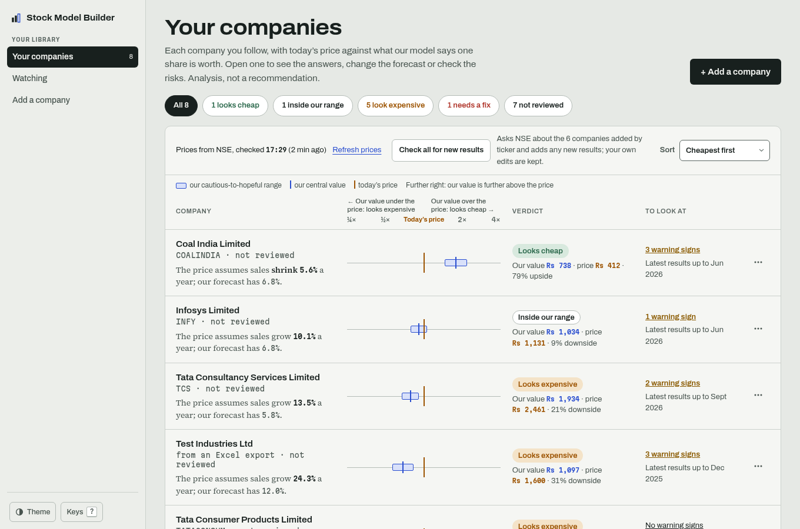
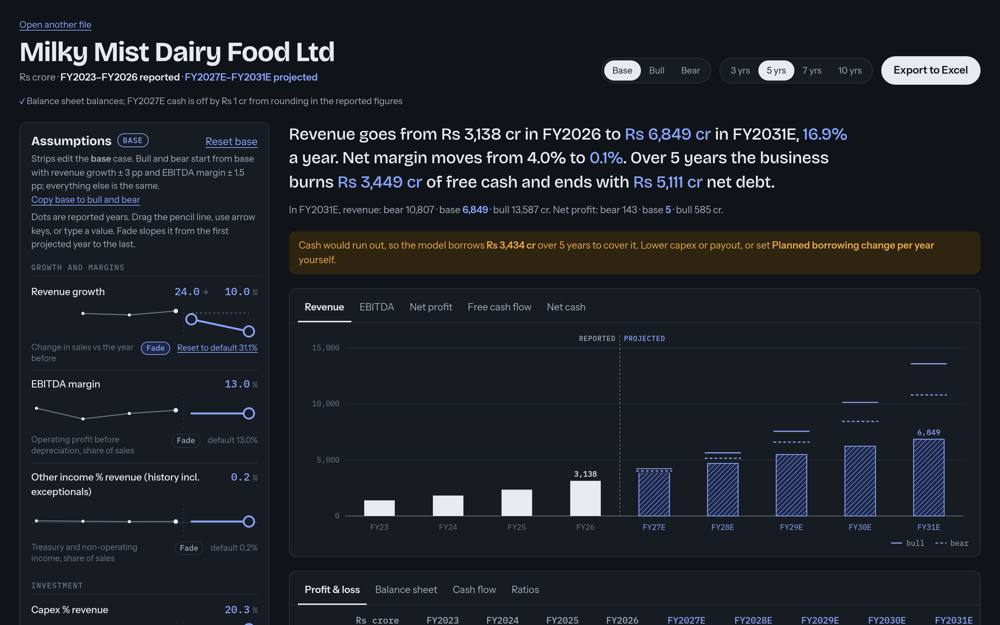

# Stock Model Builder

Turn an Indian listed company's reported financials into a three-statement forecast you can steer, then export it as an Excel model with live formulas.

Reported years are drawn in **ink**. Your assumptions are drawn in **blue pencil**: each driver is a strip showing its own history, and you drag a pencil line to set the future.



<table>
<tr>
<td></td>
<td></td>
</tr>
</table>

## What it does

- **Import:** reads a [Export.in](https://www.export.in) "Export to Excel" workbook: up to 10 years of P&L, balance sheet and cash flow, in ₹ crore.
- **Data checks:** checks the books before modelling: assets equal liabilities, lines add up to their totals, PBT less tax matches net profit, and year-end changes are flagged. Banks, NBFCs and insurers are detected and rejected with a clear message, because they need a different model.
- **Defaults from history:** revenue CAGR, three-year ratio-of-sums margins and working-capital days, and a median for lumpy items like capex and other income.
- **Three-statement projection:** P&L, balance sheet and cash flow stay linked. Cash is the balancing item, and the model borrows automatically when cash would go negative. Depreciation and interest run on opening balances, so there are no circular references.
- **Steering:** drag, type or use arrow keys on 14 drivers. "Fade" moves a driver from one value to another over the forecast.
- **Scenarios:** base, bull and bear, shown as overlays on the chart and compared in a single sentence.
- **Return ratios:** ROE, ROCE, asset turnover, net debt/EBITDA and interest cover, for history and projection.
- **One-off detection:** unusual years (tax, capex, other income, margin) are flagged with robust statistics (median and MAD). You can leave them out of the defaults.
- **DCF valuation:** free cash flow to firm discounted at a WACC you build (risk-free rate, equity risk premium, beta, cost of debt), Gordon terminal value, and a bridge to value per share. A price ruler puts today's price (ink) next to the bear, base and bull values (pencil). The Excel export has a Valuation sheet with live formulas.
- **Sensitivity and reverse DCF:** value per share across WACC × terminal growth (live formulas in Excel) and revenue growth × EBITDA margin (values, since each cell is a full re-projection), and the flat revenue growth today's price implies.
- **Multiples cross-check:** P/E, EV/EBITDA and P/B at today's price and at each scenario's value, against the company's own year-end multiples, with a flag when one sits outside its historical range.
- **Quarters and TTM:** the last ten quarters (sales, operating profit and margin, net profit, year-on-year growth) next to the last reported year and the trailing twelve months, and a sentence on TTM growth. The Excel export adds a Quarters sheet whose TTM column is live SUM formulas.
- **Restatement check:** importing a newer file for a company you've already modelled lists any overlapping reported year whose revenue, EBITDA, net profit, total assets or borrowings moved by more than 0.5%.
- **Exchange filings (XBRL):** attach an NSE/BSE financial-results XBRL file to a model. Fixed rules map about 100 standard tags to statement lines in Rs crore (including cost of materials, payables and the balance sheet when filed), list the tags they don't know, and check that PBT less tax equals profit and that revenue and net profit match Export's figure for the same year or quarter within 1%. An annual filing whose revenue matches Export's adds that year's trade payables, lease liabilities and cash-flow capex to the model (see below); other filings are kept for reference.
- **AI-proposed mappings for leftover tags (optional):** with `LLM_CMD` set to any command that reads a prompt on stdin and prints the reply (no SDK, any provider), "Propose mappings" asks the model which statement line each unknown tag is. Rules then check every answer (the line exists, the unit is right, the line isn't already filled, the sign and size are plausible, totals such as expenses and total income still tie within 1%), and you approve or reject each one. An approved mapping is saved to `mappings.json` in the model library and the filing is re-read by rules; from then on every filing applies it with no AI call. Projecting and exporting never call the model. Without `LLM_CMD` the button is off and everything else works.
- **Explain unusual years (optional, words only):** each flagged year has an Explain action. Attach that year's annual-report PDF and rules pick the few pages that mention exceptional or one-time items, the flagged line and the year (text read with the system `pdftotext`); the model answers in at most two sentences with a page and a quote, and the explanation is rejected unless that quote really occurs on that page. Without a report it can explain from the numbers only, labelled as such. Approving pins the note next to the flag, marked as AI-written; no number uses it.
- **Annual-report notes (optional):** attach a year's annual-report PDF under Sources & proposals. For segment revenue, debt maturity, capex, contingent liabilities and related-party transactions, rules pick the three most likely pages per topic, and the app shows the pages and the exact prompt size before anything is sent. The model returns each figure with its page and a quote; rules check that every quote occurs on its page and contains its number, convert the unit (lakh, million...) to Rs crore, and tie the sums to the statements (segments to revenue within 2%, maturity buckets to borrowings within 5%, capex to the XBRL cash flow when attached). A note that fails is kept as rejected. Approved notes are drawn as a segment mix, a maturity ladder, contingent liabilities against net worth and a related-party table; an approved capex figure becomes that year's capex in the history behind the default.
- **Model library:** models autosave to `models/` locally, and you can reopen any of them from the start page.
- **Excel export:** every projected statement cell is a live formula. Inputs are blue, and a scenario selector switches the whole workbook between base, bull and bear.

## How the numbers stay trustworthy

**AI proposes, rules check, you approve.** Numbers come from fixed rules; anything an AI reads is a proposal with its source, and once approved it is saved, so recalculating and exporting never call a model.

- **One engine:** `model.py` computes everything the dashboard shows.
- **The Excel export is checked against that engine.** The test suite recalculates the exported workbook in LibreOffice and compares every projected cell, in all three scenarios, with the Python results.
- **The checks are real:** they were run on 15 real Export exports (TCS, JSW Steel, Tata Motors, Bharti Airtel, Coal India, Sun Pharma, Adani Ports, and others). All lenders are correctly rejected.
- **A pre-commit hook** runs the tests and the TypeScript type check before every commit.

## Run it

Requires [uv](https://docs.astral.sh/uv/) and Node.js 20+. LibreOffice is optional; it's only used by the Excel check in the tests.

```bash
./run.sh          # installs dependencies, builds the UI, serves http://127.0.0.1:8000
./run.sh dev      # hot reload (Vite on :5173, API on :8000)
./run.sh test     # engine tests + Excel parity check
```

Then open the app, drop in a Export.in export, or click **Explore with a sample company**.

## Stack

| Part | Tech |
|---|---|
| Engine | Python, openpyxl |
| API | FastAPI (the client sends the model back with each request; the library folder also keeps uploaded filings, annual-report page text and mappings.json) |
| UI | React 18 + TypeScript + Vite, with hand-drawn SVG charts and no UI or chart libraries |
| Tests | Plain-assert self-check, plus LibreOffice headless for Excel recalculation |

```
model.py          parse, checks, defaults, projection, ratios, one-offs, valuation, Excel export
server.py         API + local model library
ai.py             LLM_CMD calls, PDF page text and picking, quote and number checks
test_model.py     self-check incl. Excel parity
web/src/          App, DriverStrip (assumption strips), Chart, Statements, Valuation, Sources
```

## Design notes

- **Ink and pencil** comes from how analysts mark up statements: actuals in ink, estimates in pencil.
- **Fonts:** Bricolage Grotesque (display), Instrument Sans (UI), IBM Plex Mono (numbers).
- **Numbers** use Indian digit grouping (1,23,456), with negatives in brackets.
- **Accessibility:** light and dark themes, works down to 390 px, keyboard-accessible sliders and tabs, and reduced motion is respected.

## Limitations

- Input is Export.in exports plus optional BSE/NSE XBRL results filings.
- Inventory and payable days run on COGS (Export's raw material cost less change in inventory) when COGS is at least 10% of revenue in each of the last three years, else on revenue. Trade payables, lease liabilities and capex from the cash-flow statement come only from attached annual XBRL filings (capex also from an approved annual-report note); without them payables stay inside other liabilities, leases inside borrowings, and capex is inferred from the change in net block. Lease liabilities count as debt in the valuation and are held flat in the projection.
- Annual-report reading needs a text PDF (scanned reports have no text) and checks only what it can tie: it reads up to three pages per topic and can miss a note printed elsewhere, and contingent liabilities and related-party items have no total to tie to, so the quote checks are their only guard. Maturity tables that show undiscounted cash flows won't tie to the carrying value of borrowings and come back rejected.
- Financial companies (banks, NBFCs, insurers) aren't supported yet.
- It's a modelling tool, not investment advice. The forecasts are only as good as the assumptions you give it.

## Roadmap

1. ~~Daily driver: scenarios, fades, ratios, one-offs, model library~~ ✓
2. ~~Valuation: DCF (FCFF), sensitivity tables, reverse DCF, multiples~~ ✓
3. ~~Richer data: BSE/NSE XBRL, AI-proposed mappings, annual-report notes, quarterly/TTM~~ ✓
4. Analyst toolkit: forecast-vs-actual tracking, anomaly radar, peer comparison, watchlist
