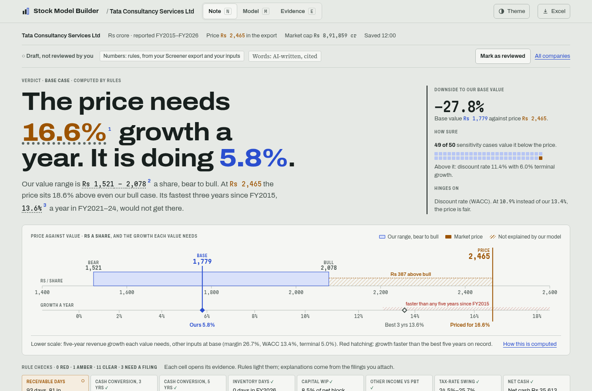
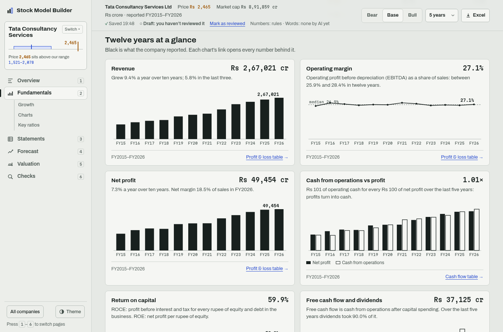
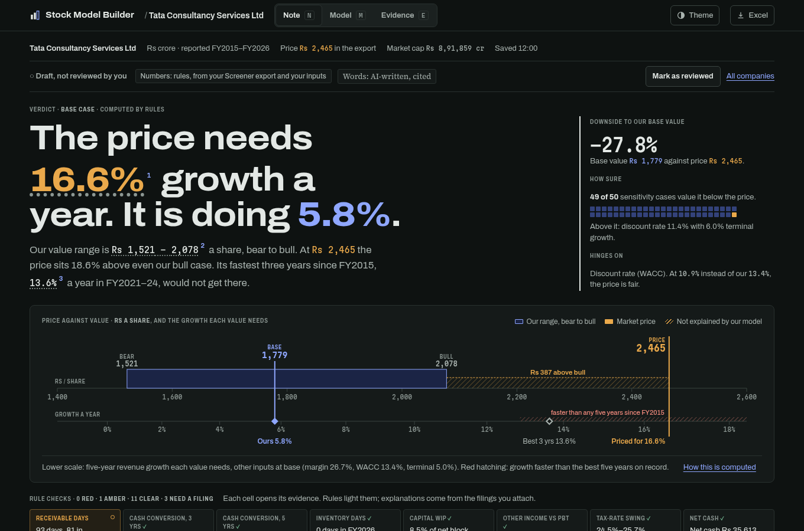

# Stock Model Builder

Open an Indian listed company and get a research note: what the price assumes against what the business does, ten years of fundamentals, the value range, what the value hinges on, the red flags and a written thesis. Behind it sit a three-statement model you can steer and an Excel export with live formulas. It runs locally as a web app with a page for every part, and the browser can install it to open in its own window.

Numbers come from fixed rules. Words come from an AI command you choose, and every number in them is checked against the model before they are saved. It is analysis, not a recommendation.



<table>
<tr>
<td></td>
<td></td>
</tr>
<tr>
<td colspan="2"></td>
</tr>
</table>

## Pages

Every page has its own address, so a link, a bookmark, a reload or a second browser tab opens exactly that page. Each company's pages sit in a rail in three groups (Answers, Work on it, Evidence), each with a quiet count or status; on a phone the four most used are along the bottom with All pages beside them. The company bar on every page holds the same controls in the same place: the company switcher, today's price, our value, the verdict ("Looks expensive · 22% downside"), the case (Cautious, Central, Hopeful), the years, Check for new results and Excel. Keys: `/` goes to any company or page, 1–6 open the answer pages, `?` lists the keys and turns them off. Older addresses (`/overview`, `/valuation`, `/checks`...) still open the page that replaced them.

| Page | Address | What it's for |
|---|---|---|
| Your companies | `/` | Every company's price today against our value on one shared scale (the price is always the middle line), the verdict word, what the price assumes against our forecast, warning signs and the latest results; Today chips to show only those that look cheap, need a fix, have new results or aren't reviewed; sort cheapest first (our value ÷ price), most warning signs, recently changed or A–Z; Refresh prices, Check all for new results; each row's ⋯ menu (Open, Saved versions, Delete with a confirm); tickers you watch before modelling them |
| Add a company | `/add` | Search by name or NSE symbol, then Build model or Watch price right on the match; a progress card that keeps running while you look elsewhere; an Excel export (`/add#upload`) or the sample company. Adding a company you already have asks first: add these years to it, keep both, or replace it (today's version is kept under Saved versions) |
| Summary | `/c/<company>/summary` | What the price assumes against what the business does: the verdict, the business in five numbers, price against value, rule checks, thesis, risks and key numbers |
| Is it cheap? | `/c/<company>/value` | The discount-rate inputs, value by case, the what-if grids, the multiples and the bridge |
| What does the price assume? | `/c/<company>/priced-in` | Works backwards from the price: what moves the value and what the price needs |
| What could go wrong? | `/c/<company>/risks` | Warning signs found by rules and unusual years |
| What changed? | `/c/<company>/changes` | New results against the forecast, input by input |
| How does it compare? | `/c/<company>/peers` | The company next to listed peers |
| Our forecast | `/c/<company>/forecast` | Every input with where it came from, the editor, drafting inputs from documents, and the projection |
| Research note | `/c/<company>/note` | The AI-written note, every number checked by rules |
| How the business is doing | `/c/<company>/business` | Growth over 3, 5 and 10 years, eight charts and a table of key ratios, each opening the statement row behind it |
| Statements | `/c/<company>/statements/<profit-and-loss, balance-sheet, cash-flow, ratios, quarters>` | Every reported line, then the forecast in blue |
| Documents and sources | `/c/<company>/documents` | The documents (attached right there), filings and the audit trail |
| Saved versions | `/c/<company>/versions` | One copy per day you changed it, plus copies kept on a replace; open any read-only (`?v=`) and restore it |

The case (bear, base, bull), the forecast years, the Excel download, the save and review status sit in the same bar on every company page. Tabs on the same company stay in step: a save in one tab reloads the others (the last save wins, and the other tab says so).

## What it does

- **Add a company by ticker:** type a name or NSE symbol and the app reads NSE's own results filings (XBRL, by rules), today's price and share count, and the latest annual report and call transcript, showing each step in plain words with Stop. It says which years came from where and which are missing; an Excel export fills older years, and where both have a year the filing wins and differences over 1% are listed (net profit compared before the minority's share; a year the export shows restated later is pointed out). Lease liabilities count as borrowings, as in the export: from FY2025 the filings describe them inside other financial liabilities and rules read them there; for earlier years the export's higher borrowings supply them, and the note says so. Uploading an export of a company you added by ticker offers to add its years to that model instead of making a second one. Banks, NBFCs and insurers stop at the first step with a plain message. The client is polite (one request a second, short timeouts, only NSE's hosts) and keeps what it downloads, so it works offline from what it has.
- **Import:** reads a 10-year financials Excel export (a workbook with a "Data Sheet" tab): up to 10 years of P&L, balance sheet and cash flow, in ₹ crore.
- **Data checks:** checks the books before modelling: assets equal liabilities, lines add up to their totals, PBT less tax matches net profit, and year-end changes are flagged. Banks, NBFCs and insurers are detected and rejected with a clear message, because they need a different model.
- **Defaults from history:** revenue CAGR, three-year ratio-of-sums margins and working-capital days, and a median for lumpy items like capex and other income. The interest-rate default is capped at 25% (since Phase 5, for every source), so a company with almost no reported borrowings doesn't project a 1,000% rate; export-only models with tiny borrowings and large interest now project less interest than before.
- **Three-statement projection:** P&L, balance sheet and cash flow stay linked. Cash is the balancing item, and the model borrows automatically when cash would go negative. Depreciation and interest run on opening balances, so there are no circular references.
- **Steering:** drag, type or use arrow keys on 14 drivers. "Fade" moves a driver from one value to another over the forecast.
- **Scenarios:** base, bull and bear, shown as overlays on the chart and compared in a single sentence.
- **Return ratios:** ROE, ROCE, asset turnover, net debt/EBITDA and interest cover, for history and projection.
- **One-off detection:** unusual years (tax, capex, other income, margin, and the minority's share of profit in years that split it) are flagged with robust statistics (median and MAD). You can leave them out of the defaults. A low capex year read off a falling net block (a disposal or transfer) is marked unreliable rather than cited as low spending.
- **Fast growers fade:** when revenue grew more than 15% a year over the last three years, the default growth fades to half its pace (at least terminal growth + 3 pp) and capex to what keeps the net block in step with revenue at that pace, instead of holding flat for every projected year.
- **Share count check:** when market cap / price gives more than 5% more shares than share capital / face value, shares were issued after the last balance sheet (an IPO or QIP), and the data check says net debt misses the proceeds.
- **DCF valuation:** free cash flow to firm discounted at a WACC you build (risk-free rate, equity risk premium, beta, cost of debt), Gordon terminal value, and a bridge to value per share. The note's ruler puts today's price next to the bear, base and bull values. The Excel export has a Valuation sheet with live formulas.
- **Sensitivity and reverse DCF:** value per share across WACC × terminal growth (live formulas in Excel) and revenue growth × EBITDA margin (values, since each cell is a full re-projection), and the flat revenue growth today's price implies.
- **Multiples cross-check:** P/E, EV/EBITDA and P/B at today's price and at each scenario's value, against the company's own year-end multiples, with a flag when one sits outside its historical range.
- **Quarters and TTM:** the last ten quarters (sales, operating profit and margin, net profit, year-on-year growth) next to the last reported year and the trailing twelve months, and a sentence on TTM growth. The Excel export adds a Quarters sheet whose TTM column is live SUM formulas.
- **Restatement check:** importing a newer file for a company you've already modelled lists any overlapping reported year whose revenue, EBITDA, net profit, total assets or borrowings moved by more than 0.5%.
- **Exchange filings (XBRL):** attach an NSE/BSE financial-results XBRL file to a model. Fixed rules map about 100 standard tags to statement lines in Rs crore (including cost of materials, payables and the balance sheet when filed), list the tags they don't know, and check that PBT less tax equals profit and that revenue and net profit match the export's figure for the same year or quarter within 1%. An annual filing whose revenue matches the export's adds that year's trade payables, lease liabilities and cash-flow capex to the model (see below); other filings are kept for reference.
- **AI-proposed mappings for leftover tags (optional):** with `LLM_CMD` set to any command that reads a prompt on stdin and prints the reply (no SDK, any provider), "Propose mappings" asks the model which statement line each unknown tag is. Rules then check every answer (the line exists, the unit is right, the line isn't already filled, the sign and size are plausible, totals such as expenses and total income still tie within 1%), and you approve or reject each one. An approved mapping is saved to `mappings.json` in the model library and the filing is re-read by rules; from then on every filing applies it with no AI call. Projecting and exporting never call the model. Without `LLM_CMD` the button is off and everything else works.
- **Explain unusual years (optional, words only):** each flagged year has an Explain action. Attach that year's annual-report PDF and rules pick the few pages that mention exceptional or one-time items, the flagged line and the year (text read with the system `pdftotext`); the model answers in at most two sentences with a page and a quote, and the explanation is rejected unless that quote really occurs on that page. Without a report it can explain from the numbers only, labelled as such. Approving pins the note next to the flag, marked as AI-written; no number uses it.
- **Annual-report notes (optional):** attach a year’s annual-report PDF on Documents and sources. For segment revenue, debt maturity, capex, contingent liabilities, related-party transactions, exceptional items, promoter pledge and the auditor's report, rules pick the most likely pages per topic (three; the auditor gets a slot for its signature page), and the app shows the pages and the exact prompt size before anything is sent. The model returns each figure with its page and a quote; rules check that every quote occurs on its page and contains its number, convert the unit (lakh, million...) to Rs crore (pledge is a percentage from 0 to 100, a quoted "nil" counting as 0; the auditor's report is words only: the firm, the opinion and whether the auditor changed, each checked against a quote on its page; exceptional items are words and citations for the note, never fed to the engine), and tie the sums to the statements (segments to revenue within 2%, maturity buckets to borrowings within 5%, capex to the XBRL cash flow when attached). A note that fails is kept as rejected. Approved notes are drawn as a segment mix, a maturity ladder, contingent liabilities against net worth and a related-party table; an approved capex figure becomes that year's capex in the history behind the default.
- **Summary:** the answer in two sentences by rules ("At Rs 2,465 the market pays more than even our hopeful value. For the price to be fair, sales would need to grow 13.5% a year; TCS has managed 5.8% a year over the last three."), then five answer cards: Is it cheap? on the shared scale, what the price assumes against the best five and last three years, the warning signs by severity, what changed with Check for new results, and how it compares with its peers. Each card opens the page with the evidence. Below sit the research note's three points, where the numbers come from, and Mark as reviewed.
- **Research note:** the rules' verdict, the AI's three points, priced in, risks and what to watch, and the key numbers; every cited number has a footnote with its source.
- **What could go wrong?:** each warning sign as a card with a plain title ("Customers are paying more slowly"), one severity word everywhere (Serious, Worth a look, Minor, Passed, Not checked yet), why it matters, what the rule checked, a small chart of the flagged years, and links to its numbers and its forecast input. Checks that wait name the real blocker (no annual report, AI reading off, or not read yet). Years that stand out are listed apart and never counted as warnings; leaving one out of the rules' figures offers the moved figures in one click.
- **How the business is doing, Statements, Documents and sources:** twelve years of reported growth, charts and ratios with a one-sentence answer; every statement line opening at the first year with a jump to the latest; and one page for the documents read, where each year's numbers came from, the filings line by line, annual-report reading, the audit trail, the AI setting and deleting the model.
- **Forensic radar:** 15 rules for cash conversion, receivable and inventory days, capital WIP, other income, tax swings, debt and interest cover, working capital, a Beneish-style M-score, and (from approved annual-report notes) contingent liabilities, related parties, promoter pledge and the auditor. Each lit flag can be explained from the annual report with a checked quote.
- **Drafted assumptions:** attach annual reports, earnings-call transcripts or investor presentations, and the AI command proposes bear, base and bull for every driver with a page and a quote. Rules check the quote, the bounds, the company's own 10-year history (a value outside it needs a quote that prints that figure; a quote with no number gets a "size not in the source" note), the order of the cases and the cash consequences; you accept, edit or reject each one.
- **Thesis writer:** "Write the note" sends the AI command only the numbers on the note (verdict, what moves value, break-evens, key numbers, lit flags, inputs and their sources) and the quotes you approved, never whole pages. It writes a headline, three thesis points, what is priced in, risks, bull and bear triggers and what to watch. Rules reject it unless every number is one the app computed or one in a cited quote, every reference exists, every quote is on its page (a quote from a report whose text is gone only if it was approved), nothing says buy, sell, target price or recommend, nothing says never, always or ever (the history starts at the export's first year), and each part fits its length; a failure is retried once with the reasons, then shown. The saved note is marked AI-written; when an input changes it is marked "written for earlier inputs", and it is only rewritten when you ask.
- **Peers:** rules list companies in the same NSE sector, close in size, same industry first; the AI command picks 4–8 with a one-line reason each, rules check every pick (on the list, not the company itself, data available, no buy/sell words), and you tick and approve them. With AI off, rules tick the same-industry candidates for you to approve. Rules then build the comparison table (P/E, EV/EBITDA and P/B first, then size, growth, margins, returns, cash conversion, leverage) and rank the company, with every net-cash company tied as the least indebted; the Excel export adds a Peers sheet. When no candidate shares the company's industry (NSE's sectors are the limit: a coal miner's peers sit in Metals & Mining), the page says so.
- **Tracking new results:** when new annual results come in, the forecast as it stood is kept, scored input by input against what was reported (a hit is within one step), and What changed? shows it: the lines against the forecast, the value range and the growth the price needs before and after, and new or cleared warning signs. Inputs that missed are offered the new rule default; assumptions never change by themselves.
- **Watchlist:** Your companies shows each company's price today (refreshed from NSE when the page opens and the price is over 15 minutes old, with the time it was checked) against our value range, upside to our base value, what the price assumes against our growth, warning signs, the latest results and a "new results" tag, sorted by cheapest against our value, most warning signs or recently changed, and filtered the same way. A small line per company draws price against our base value day by day. Tickers can be watched before modelling them, with a Build model button. Offline, the last prices kept are shown with their time.
- **Model library:** models autosave to `models/` locally, and you can reopen any of them from Your companies or the company switcher.
- **An installable app:** a web app manifest and icons, so Chrome or Edge offers "Install app" and opens it in its own window. Old `#note`, `#model` and `#evidence` links still open the right page.
- **Excel export:** every projected statement cell is a live formula. Inputs are blue, and a scenario selector switches the whole workbook between base, bull and bear.

## How the numbers stay trustworthy

**AI proposes, rules check, you approve.** Numbers come from fixed rules; anything an AI reads is a proposal with its source, and once approved it is saved, so recalculating and exporting never call a model.

- **One engine:** `model.py` computes everything the dashboard shows.
- **The Excel export is checked against that engine.** The test suite recalculates the exported workbook in LibreOffice and compares every projected cell, in all three scenarios, with the Python results.
- **The checks are real:** they were run on 15 real Excel exports (TCS, JSW Steel, Tata Motors, Bharti Airtel, Coal India, Sun Pharma, Adani Ports, and others). All lenders are correctly rejected.
- **A pre-commit hook** runs the tests and the TypeScript type check before every commit.

## Run it

Requires [uv](https://docs.astral.sh/uv/) and Node.js 20+. LibreOffice is optional; it's only used by the Excel check in the tests.

```bash
./run.sh          # installs dependencies, builds the UI, serves http://127.0.0.1:8000
./run.sh dev      # hot reload (Vite on :5173, API on :8000)
./run.sh test     # engine tests + Excel parity check (offline: NSE's answers are recorded fixtures)
LIVE_NET=1 uv run python test_model.py   # also asks NSE itself, a handful of polite requests, to catch a changed API
```

Then open the app, drop in an Excel export, or click **Try the sample company**. To use it like a desktop app, choose **Install app** in the browser's address bar.

## Stack

| Part | Tech |
|---|---|
| Engine | Python, openpyxl |
| API | FastAPI (the client sends the model back with each request; the library folder also keeps uploaded filings, annual-report page text and mappings.json) |
| UI | React 18 + TypeScript + Vite, with hand-drawn SVG charts and no UI or chart libraries |
| Tests | Plain-assert self-check, plus LibreOffice headless for Excel recalculation |

```
model.py          parse, checks, defaults, projection, ratios, one-offs, valuation, Excel export
server.py         API + local model library and watchlist
sources.py        NSE client: search, quote, results filings, reports; polite, allow-listed, cached
ai.py             LLM_CMD calls, PDF page text and picking, quote and number checks
test_model.py     self-check incl. Excel parity
web/src/          App (routing, autosave, tab sync, keys), Shell (rail, company bar, switcher, dialogs, scale), Workspace, Home + Watch (Your companies), Add, Fetch, Peers, Tracking, Summary, Note (research note), Fundamentals (business), Statements,
                  Model (Forecast), Valuation, Risks, Documents, Ruler, Draft, DriverStrip, Chart, Sources, route
```

## Design notes

- **Type is provenance:** Martian Mono for every number computed by rules, Source Serif 4 for written words (AI prose, quotes), Archivo for the interface.
- **Colour is who says it:** ochre for the market price, blue for our model, carmine for a lit rule, green for a passed check, black for reported history.
- **Numbers** use Indian digit grouping (1,23,456), with negatives in brackets.
- **Navigation:** a sidebar with the company switcher and the six pages (the open page lists its sections); on a phone, a top bar and the pages along the bottom. Every page opens with what it is for and its next step; every navigation item is a real link.
- **Accessibility:** landmarks, a skip link, focus on the page heading after a page change, light and dark themes, works down to 390 px, keyboard-accessible sliders and tabs, and reduced motion is respected.

## Limitations

- Input is NSE's filings by ticker, Excel exports, or both. NSE's XBRL results only build full years from FY2023 (earlier filings have no balance sheet), so a company added by ticker alone has about four years until an Excel export fills the rest. Exchange sites can change their pages or refuse automated requests for a while; the app then says so, keeps what it already downloaded, and uploading an Excel export or an XBRL file by hand always works. BSE-only companies aren't fetched yet.
- Inventory and payable days run on COGS (the export's raw material cost less change in inventory) when COGS is at least 10% of revenue in each of the last three years, else on revenue. Trade payables, lease liabilities and capex from the cash-flow statement come only from attached annual XBRL filings (capex also from an approved annual-report note); without them payables stay inside other liabilities, leases inside borrowings, and capex is inferred from the change in net block. A company added by ticker alone has no lease liabilities before FY2025 (those filings leave them in other liabilities) unless an Excel export fills them. Lease liabilities count as debt in the valuation and are held flat in the projection.
- Annual-report reading needs a text PDF (scanned reports have no text) and checks only what it can tie: it reads up to three pages per topic and can miss a note printed elsewhere, and contingent liabilities and related-party items have no total to tie to, so the quote checks are their only guard. Maturity tables that show undiscounted cash flows won't tie to the carrying value of borrowings and come back rejected.
- The thesis writer checks numbers by value, not by meaning: a number that matches a computed fact passes even if the sentence attaches it to the wrong thing, so read the note before marking it reviewed. It knows only what the app computed and the quotes you approved: no management access, channel checks or industry news.
- Financial companies (banks, NBFCs, insurers) aren't supported yet.
- It's a modelling tool, not investment advice. The forecasts are only as good as the assumptions you give it.

## Roadmap

1. ~~Daily driver: scenarios, fades, ratios, one-offs, model library~~ ✓
2. ~~Valuation: DCF (FCFF), sensitivity tables, reverse DCF, multiples~~ ✓
3. ~~Richer data: BSE/NSE XBRL, AI-proposed mappings, annual-report notes, quarterly/TTM~~ ✓
4. ~~The analyst: research note first, assumptions proposed from filings and concalls, forensic red-flag radar, thesis writer~~ ✓
5. ~~Hands-off coverage: fetch by ticker, automatic peers, tracking results against the forecast, watchlist~~ ✓
