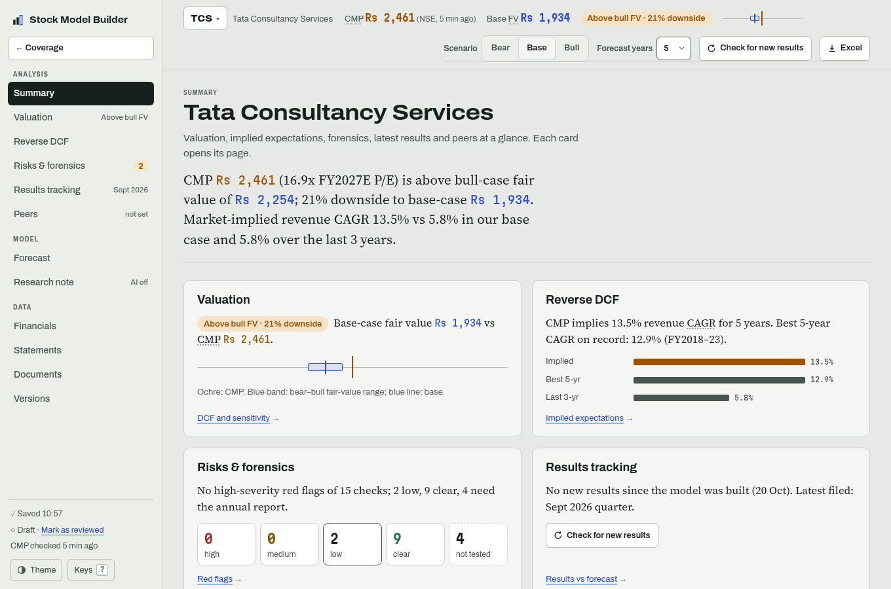
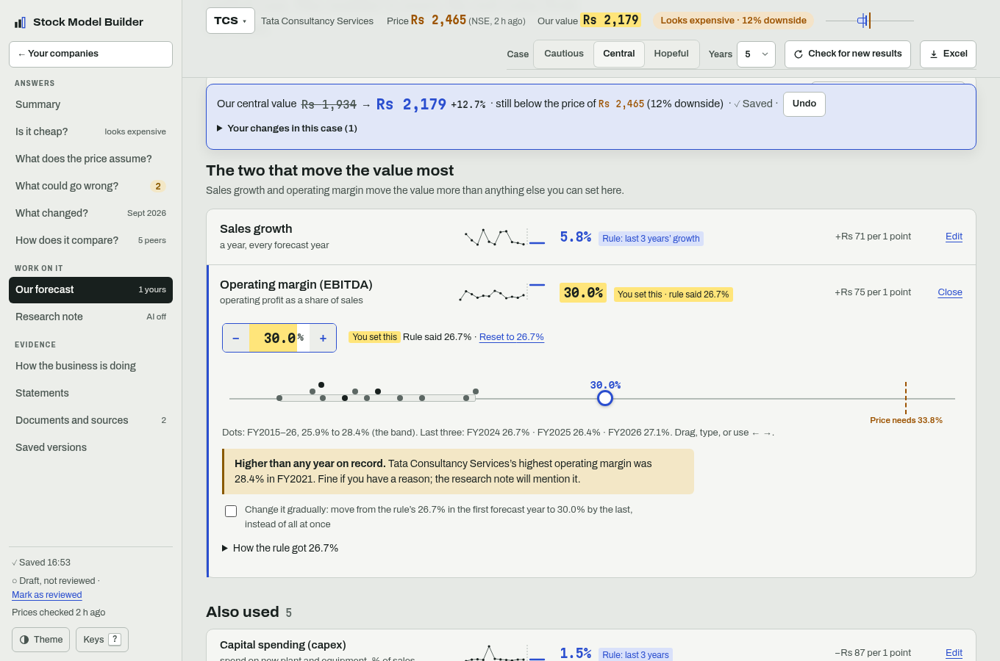
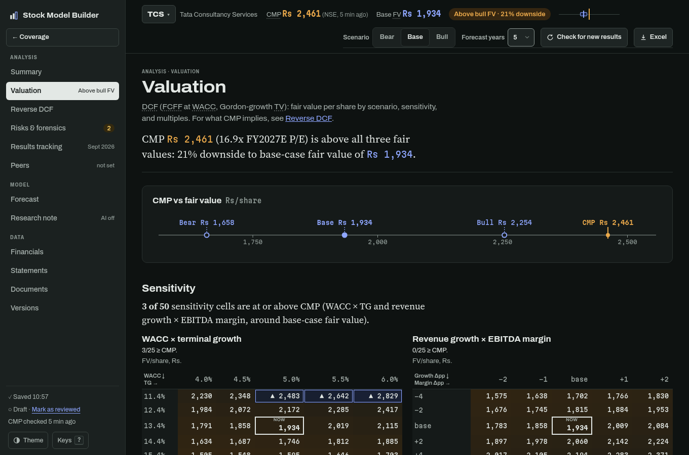

# Stock Model Builder

Open an Indian listed company and get a research note: CMP against DCF fair value (bear, base, bull), what the market implies (reverse DCF), ten years of fundamentals, sensitivity, forensic red flags and a written thesis. Behind it sit a three-statement model you can steer and an Excel export with live formulas. It runs locally as a web app with a page for every part, and the browser can install it to open in its own window.

Numbers come from fixed rules. Words come from an AI command you choose, and every number in them is checked against the model before they are saved. It is analysis, not a recommendation: no price targets, no buy/sell calls.



<table>
<tr>
<td></td>
<td></td>
</tr>
<tr>
<td colspan="2"></td>
</tr>
</table>

## Pages

Every page has its own address, so a link, a bookmark, a reload or a second browser tab opens exactly that page. Each company's pages sit in a rail in three groups (Analysis, Model, Data), each with a quiet count or status; on a phone, Summary, Valuation, Risks and Forecast are along the bottom with All pages beside them. The company bar on every page holds the same controls in the same place: the company switcher, CMP, fair value for the active scenario, the verdict ("Above bull FV · 21% downside"), the scenario (Bear, Base, Bull), forecast years, Check for new results and Excel. Every page opens with an answer line ("CMP Rs 2,461 (16.9x FY2027E P/E) is above bull-case fair value of Rs 2,254; 21% downside to base-case Rs 1,934. Market-implied revenue CAGR 13.5% vs 5.8% in our base case") and ends with its next step. Standard abbreviations (CMP, FV, WACC, FCFF, TG, EV, CAGR, ROCE, P/E...) are labelled as such, with a terse definition on hover and on keyboard focus, from one glossary (`web/src/Term.tsx`). Keys: `/` goes to any company or page, 1–6 open the Analysis pages, `?` lists the keys and turns them off. Older addresses (`/value`, `/priced-in`, `/changes`, `/business`, `/overview`, `/valuation#hinges`, `/checks`...) still open the page that replaced them.

| Page | Address | What it's for |
|---|---|---|
| Coverage | `/` | Every company's CMP against its bear–bull fair-value range on one shared log scale (CMP is always the middle line), the verdict, reverse-DCF implied growth vs the base case, red flags and latest results; filter chips (below bear FV, within range, above bull FV, needs a fix, new results, not reviewed); sort by upside (FV ÷ CMP), most red flags, recently changed or A–Z; Refresh prices, Check all for new results; each row's ⋯ menu (Open, Versions, Delete with a confirm); the watchlist of tickers not yet modelled |
| Portfolio | `/portfolio` | Your holdings (symbol, quantity, average cost; typed or pasted as CSV) at CMP: market value, weight, unrealised P&L, base-case FV and upside per holding and for the portfolio, look-through P/E, EV/EBITDA (ex-lenders) and P/B (lenders), NSE sector exposure, top-5 weight and HHI, red flags and new results by holding, Build model for a holding without one, and an Excel export |
| Add company | `/add` | Search by name or NSE symbol, then Build model or Watch price right on the match; a progress card that keeps running while you look elsewhere; an Excel export (`/add#upload`) or the sample company. Adding a company you already have asks first: add these years to it, keep both, or replace it (the current version is kept under Versions) |
| Summary | `/c/<company>/summary` | The answer line, five cards (Valuation, Reverse DCF, Risks & forensics, Results tracking, Peers) that each open their page, a quick sensitivity line for revenue growth and EBITDA margin, the note's thesis points and Mark as reviewed |
| Valuation | `/c/<company>/valuation` | DCF: CMP vs bear/base/bull fair value, sensitivity (WACC × TG and revenue growth × EBITDA margin, ▲ where a cell is at or above CMP), P/E, EV/EBITDA and P/B at CMP and at fair value against the peer median and own history, TV share of EV; the eight DCF inputs and the EV-to-equity bridge folded below |
| Reverse DCF | `/c/<company>/reverse-dcf` | Implied expectations: the ruler (fair value and the revenue growth each implies), and break-even drivers, each flexed one step with the level at which base-case FV equals CMP, tagged "above track record", "within track record" or "judgemental". For a bank or NBFC the page is **Implied RoE**: the steady-state RoE today's P/B prices in, against the base case and the record, FV at a steady RoE, and what moves value |
| Risks & forensics | `/c/<company>/risks` | Red flags by rules (High, Medium, Low, Clear, Not tested), incl. Beneish M-score and disclosure checks; outlier years listed apart |
| Results tracking | `/c/<company>/tracking` | Check for new results; the quarters filed this year (Q1, H1, 9M) against the base case's FY E run-rate; actual vs forecast, the effect on fair value and implied growth, driver revisions to accept, and variance by driver (`#by-input`) |
| Peers | `/c/<company>/peers` | Relative valuation against listed peers, with why these peers, standard column names with their direction ("↓ cheaper"), and changing the set |
| Forecast | `/c/<company>/forecast` | The drivers in three tiers (key value drivers, other drivers, balance-sheet items folded), each opening in place to edit; Suggest from documents; forecast output |
| Research note | `/c/<company>/note` | The AI-drafted note, every number checked by rules; each cited number opens its source beside it |
| Financials | `/c/<company>/financials` | 3-, 5- and 10-year CAGRs, eight charts and key ratios, each opening the statement row behind it |
| Statements | `/c/<company>/statements/<profit-and-loss, balance-sheet, cash-flow, ratios, quarters>` | P&L, balance sheet, cash flow, ratios and quarterly results: every reported line, then the forecast in blue; older years whose filings have no balance sheet open the table as P&L only |
| Documents | `/c/<company>/documents` | The documents (attached right there), a box to ask them a question, data lineage, filings and the audit trail |
| Ask the filings | `/c/<company>/ask` | Ask a question of the attached annual reports, transcripts and presentations (suggested analyst questions: guidance, capex plans, margin drivers, order book, capital allocation, risks; a lender gets loan growth, NIM, asset quality, deposits and capital); the answer with page citations that open the page text, its rule checks, and every question asked before. Without AI, keyword search over the pages |
| Versions | `/c/<company>/versions` | One copy per day it changed, plus copies kept on a replace; open any read-only (`?v=`) and restore it |

After any change that moves fair value, a bar under the company bar shows fair value before and after, the gap to CMP, whether it's saved, and Undo, with the drivers edited in this scenario and Reset all to rule defaults. Edited numbers are highlighted in yellow ("Edited · default 26.7%"); rule defaults are blue, the AI's suggestions purple until you use them. Tabs on the same company stay in step: a save in one tab reloads the others (the last save wins, and the other tab says so).

## What it does

- **Add a company by ticker:** type a name or NSE symbol and the app reads NSE's own results filings (XBRL, by rules), today's price and share count, and the latest annual report and call transcript, showing each step in plain words with Stop. It says which years came from where and which are missing; an Excel export fills older years, and where both have a year the filing wins and differences over 1% are listed (net profit compared before the minority's share; a year the export shows restated later is pointed out). Lease liabilities count as borrowings, as in the export: from FY2025 the filings describe them inside other financial liabilities and rules read them there; for earlier years the export's higher borrowings supply them, and the note says so. Uploading an export of a company you added by ticker offers to add its years to that model instead of making a second one. Banks and NBFCs take the lender template (below); insurers stop at the first step with a plain message. The client is polite (one request a second, short timeouts, only NSE's hosts) and keeps what it downloads, so it works offline from what it has.
- **Banks and NBFCs (lender template):** detected by NSE's industry (or, for an Excel export, a loan book with interest over a fifth of revenue) and read from their standalone results XBRL (banks file asset quality and CET1 only there; a consolidated bank carries its insurer's policyholder funds): interest earned and expended, other income, operating expenses, provisions, deposits, borrowings, investments, advances, GNPA/NNPA and CET1 for banks; finance costs, impairment and loans for NBFCs (Ind AS). Older years come from an export, where provisions sit inside operating expenses. Drivers: loan growth, NIM (NII ÷ average total assets), fee and other income, cost-to-income, credit cost (provisions ÷ average advances), tax, payout, advances % assets, RWA density and a CET1 floor below which equity is raised at year end. The projection rolls a lender's balance sheet and P&L (NII, PPOP, provisions, PAT) with the RoA tree. Valuation is residual income from book (no FCFF DCF: deposits are a lender's raw material), with justified P/B = (RoE − g) ÷ (Ke − g), P/B, P/ABV and P/E at CMP and at fair value, a Ke × RoE grid and the market-implied RoE (and Ke). Forensic rules: GNPA rising, provision coverage falling, credit cost spikes, NIM compression, yield vs cost of funds, the credit-deposit ratio, thin CET1, profit leaning on other income, related parties from the annual report. Peers compare P/B, P/E, loan growth, NIM, cost-to-income, credit cost, RoA, RoE, GNPA and CET1. The Excel export has lender Model and Valuation sheets with live formulas, checked against Python in LibreOffice (a synthetic bank in every test run; HDFC Bank and Bajaj Finance through the real fetch with `LIVE_NET=1`).
- **BSE fallback:** when NSE has no data for a ticker or refuses, the app looks the ticker up on BSE and reads BSE's results XBRL files, price and announcements (call transcripts, presentations) with the same polite client (allow-listed hosts, one request a second, size caps, cache). A company listed only on BSE is added by name or by its six-digit scrip code. BSE's list doesn't say each file's period or basis, so each file is read for them; annual reports from BSE are attached by hand. BSE's API refuses automated requests from some networks; the app then says so.
- **P&L-only years:** NSE's annual results filings before FY2023 carry a P&L but no balance sheet. Where no Excel export covers those years, their P&L opens the Statements table (marked P&L only, balance sheet and cash flow blank) and feeds the revenue CAGR track record; defaults, balance-sheet ratios and forensic checks start at the first full year.
- **Scheduled checks:** on app start (if the last run is over an hour old) and once a day while the app runs, prices and new results are checked in the background for every company added by ticker, rules only, through the same cache and polite client. New results are saved as a new version (assumptions never change), Coverage marks them "new results", and an open company reloads with them. Coverage shows the last run and has Turn off. Start the app with `AUTO_CHECKS=0` to never start them (offline use, or a second copy of the app on the same models folder: Turn off is stored in `models/auto.json` and would switch off both).
- **Import:** reads a 10-year financials Excel export (a workbook with a "Data Sheet" tab): up to 10 years of P&L, balance sheet and cash flow, in ₹ crore.
- **Data checks:** checks the books before modelling: assets equal liabilities, lines add up to their totals, PBT less tax matches net profit, and year-end changes are flagged. Banks and NBFCs go to the lender template; insurers are rejected with a clear message, because they need a different model.
- **Defaults from history:** revenue CAGR, three-year ratio-of-sums margins and working-capital days, and a median for lumpy items like capex and other income. The interest-rate default is capped at 25% (since Phase 5, for every source), so a company with almost no reported borrowings doesn't project a 1,000% rate; export-only models with tiny borrowings and large interest now project less interest than before.
- **Three-statement projection:** P&L, balance sheet and cash flow stay linked. Cash is the balancing item, and the model borrows automatically when cash would go negative. Depreciation and interest run on opening balances, so there are no circular references.
- **Steering:** each input opens in place: type in the box, step it with − and +, or drag the track (arrow keys too) past the reported years, with what the price needs marked. Going beyond the company's record says so. "Change it gradually" moves an input from the rule's figure to yours over the forecast.
- **A business that left the group:** on Forecast (revenue growth) or from an approved annual-report note, its revenue and EBITDA leave the base year before growth applies; if it still sits in the base balance sheet, its net block and borrowings leave the opening balance sheet too (its net assets leave reserves), so EV, net debt, WACC weights and capital employed describe the group that stays. Excel shows them as blue inputs and the first forecast column and the Valuation bridge read the base year less them.
- **Scenarios:** bear, base and bull (bull and bear seeded at base ± 3 pp revenue growth and ± 1.5 pp EBITDA margin), the same names in the app and the Excel sheets, shown as overlays on the chart and compared in a single line.
- **Return ratios:** ROE, ROCE, asset turnover, net debt/EBITDA and interest cover, for history and projection.
- **One-off detection:** unusual years (tax, capex, other income, margin, and the minority's share of profit in years that split it) are flagged with robust statistics (median and MAD). You can leave them out of the defaults. A low capex year read off a falling net block (a disposal or transfer) is marked unreliable rather than cited as low spending.
- **Fast growers fade:** when revenue grew more than 15% a year over the last three years, the default growth fades to half its pace (at least terminal growth + 3 pp) and capex to what keeps the net block in step with revenue at that pace, instead of holding flat for every projected year.
- **Share count check:** when market cap / price gives more than 5% more shares than share capital / face value, shares were issued after the last balance sheet (an IPO or QIP), and the data check says net debt misses the proceeds.
- **DCF valuation:** free cash flow to firm discounted at a WACC you build (risk-free rate, equity risk premium, beta, cost of debt), Gordon terminal value, and a bridge to value per share. The ruler puts CMP next to the bear, base and bull fair values. A forecast whose final-year FCFF is negative has no fair value, and the app says so with the exact final-year capex or EBITDA margin that turns FCFF positive (one click on Forecast); a fair value at or below zero is treated the same way, never as a value. The Excel export has a Valuation sheet with live formulas.
- **Sensitivity and reverse DCF:** value per share across WACC × terminal growth (live formulas in Excel) and revenue growth × EBITDA margin (values, since each cell is a full re-projection), and the flat revenue growth today's price implies.
- **Multiples cross-check:** P/E, EV/EBITDA and P/B at today's price and at each scenario's value, against the company's own year-end multiples, with a flag when one sits outside its historical range.
- **Quarters and TTM:** the last ten quarters (sales, operating profit and margin, net profit, year-on-year growth) next to the last reported year and the trailing twelve months, and a sentence on TTM growth. The Excel export adds a Quarters sheet whose TTM column is live SUM formulas.
- **Restatement check:** importing a newer file for a company you've already modelled lists any overlapping reported year whose revenue, EBITDA, net profit, total assets or borrowings moved by more than 0.5%. A year a later filing restated keeps its first-filed numbers until you switch it to the restated ones in one click (Documents, where both figures are shown); the Summary points there while the numbers aren't like for like.
- **Exchange filings (XBRL):** attach an NSE/BSE financial-results XBRL file to a model. Fixed rules map about 100 standard tags to statement lines in Rs crore (including cost of materials, payables and the balance sheet when filed), list the tags they don't know, and check that PBT less tax equals profit and that revenue and net profit match the export's figure for the same year or quarter within 1%. An annual filing whose revenue matches the export's adds that year's trade payables, lease liabilities and cash-flow capex to the model (see below); other filings are kept for reference.
- **AI-proposed mappings for leftover tags (optional):** with `LLM_CMD` set to any command that reads a prompt on stdin and prints the reply (no SDK, any provider), "Propose mappings" asks the model which statement line each unknown tag is. Rules then check every answer (the line exists, the unit is right, the line isn't already filled, the sign and size are plausible, totals such as expenses and total income still tie within 1%), and you approve or reject each one. An approved mapping is saved to `mappings.json` in the model library and the filing is re-read by rules; from then on every filing applies it with no AI call. Projecting and exporting never call the model. Without `LLM_CMD` the button is off and everything else works.
- **Explain unusual years (optional, words only):** each flagged year has an Explain action. Attach that year's annual-report PDF and rules pick the few pages that mention exceptional or one-time items, the flagged line and the year (text read with the system `pdftotext`); the model answers in at most two sentences with a page and a quote, and the explanation is rejected unless that quote really occurs on that page. Without a report it can explain from the numbers only, labelled as such. Approving pins the note next to the flag, marked as AI-written; no number uses it.
- **Annual-report notes (optional):** attach a year’s annual-report PDF on Documents. For segment revenue, debt maturity, capex, contingent liabilities, related-party transactions, exceptional items, promoter pledge, the auditor's report, a business that moved out of the group and operating numbers (order book, headcount, volumes), rules pick the most likely pages per topic (three; the auditor gets a slot for its signature page), and the app shows the pages and the exact prompt size before anything is sent. The model returns each figure with its page and a quote; rules check that every quote occurs on its page and contains its number, convert the unit (lakh, million...) to Rs crore (pledge is a percentage from 0 to 100, a quoted "nil" counting as 0; the auditor's report is words only: the firm, the opinion and whether the auditor changed, each checked against a quote on its page; exceptional items are words and citations for the note, never fed to the engine), and tie the sums to the statements (segments to revenue within 2%, maturity buckets to borrowings within 5%, capex to the XBRL cash flow when attached). A note that fails is kept as rejected. Approved notes are drawn as a segment mix, a maturity ladder, contingent liabilities against net worth and a related-party table; an approved capex figure becomes that year's capex in the history behind the default.
- **Summary:** the answer line by rules ("CMP Rs 2,461 (16.9x FY2027E P/E) is above bull-case fair value of Rs 2,254; 21% downside to base-case Rs 1,934. Market-implied revenue CAGR 13.5% vs 5.8% in our base case and 5.8% over the last 3 years."), then five cards: Valuation on the shared scale, Reverse DCF against the best 5-year and last 3-year CAGR, red flags by severity, Results tracking with Check for new results, and Peers. Each card opens the page with the evidence. Below sit the research note's thesis points, the data sources, and Mark as reviewed.
- **Research note:** the rules' valuation line, the AI's three-point thesis, priced in, risks and monitorables, and key metrics; every cited number opens its source beside it without moving the page.
- **Risks & forensics:** each red flag as a card with a standard title ("Debtor days rising"), one severity scale everywhere (High, Medium, Low, Clear, Not tested), why it matters, the rule and threshold, a small chart of the flagged years, and links to its statement line and its forecast driver. Untested checks name the real blocker (no annual report, AI reading off, or not read yet). Outlier years are listed apart and never counted as flags; excluding one from the rule defaults offers the moved defaults in one click.
- **Financials, Statements, Documents:** up to twelve years of reported CAGRs, charts and ratios with an answer line; every statement line opening at the first year with a jump to the latest; and one page for the documents read, where each year's numbers came from, the filings line by line, annual-report reading, the audit trail, the AI setting and deleting the model.
- **Forensic radar:** 15 rules for cash conversion, receivable and inventory days, capital WIP, other income, tax swings, debt and interest cover, working capital, a Beneish-style M-score, and (from approved annual-report notes) contingent liabilities, related parties, promoter pledge and the auditor. Each lit flag can be explained from the annual report with a checked quote.
- **Drafted assumptions:** attach annual reports, earnings-call transcripts or investor presentations, and the AI command proposes the bear, base and bull cases for every driver with a page and a quote. Rules check the quote, the bounds, the company's own 10-year history (a value outside it needs a quote that prints that figure; a quote with no number gets a "size not in the source" note), the order of the cases and the cash consequences; you accept, edit or reject each one.
- **Ask the filings:** a question about the attached documents. Rules pick the six pages that best match it (BM25 keyword scoring over every page, no index or vector store); the AI command answers from those pages only, in at most four sentences with a page and a quote for each claim. Rules reject an answer unless every citation is a page that was sent, every quote occurs on its page, every number in the answer is printed on a cited page and nothing reads as a recommendation; a failure is retried once with the reasons, then saved as "couldn't answer from the filings". Answers are kept per company (question, answer, citations, date) in `models/_answers/` and never change a number. When management gives a figure for a forecast driver ("revenue growth guidance of 1.5% to 3%"), the answer offers it as a proposal: the drafting rules check it (plus the figure must be printed in its quote) and you Use it or keep yours on Forecast. Without `LLM_CMD`, the same page search runs as plain keyword search.
- **Thesis writer:** "Write the note" sends the AI command only the numbers on the note (verdict, what moves value, break-evens, key numbers, lit flags, inputs and their sources) and the quotes you approved, never whole pages. It writes, in analyst register with standard terms, a headline, three thesis points, what is priced in, risks, what would lift or lower fair value and monitorables. Rules reject it unless every number is one the app computed or one in a cited quote, every reference exists, every quote is on its page (a quote from a report whose text is gone only if it was approved), nothing says buy, sell, target price or recommend, nothing says never, always or ever (the history starts at the export's first year), and each part fits its length; a failure is retried once with the reasons, then shown. The saved note is marked AI-written; when an input changes it is marked "written for earlier inputs", and it is only rewritten when you ask.
- **Peers:** rules list companies in the same NSE sector, close in size, same industry first; the AI command picks 4–8 with a one-line reason each, rules check every pick (on the list, not the company itself, data available, no buy/sell words), and you tick and approve them. With AI off, rules tick the same-industry candidates for you to approve. Rules then build the comparison table (P/E, EV/EBITDA and P/B first, then size, growth, margins, returns, cash conversion, leverage) and rank the company, with every net-cash company tied as the least indebted; the Excel export adds a Peers sheet. When no candidate shares the company's industry (NSE's sectors are the limit: a coal miner's peers sit in Metals & Mining), the page says so.
- **Quarterly tracking:** each quarter filed in the first forecast year is scored YTD against the base case's FY E: revenue and PAT against FY E times the share of last year the same quarters made (straight quarters / 4 when last year's aren't filed), EBITDA margin in bps against FY E. Within 2% (revenue), 5% (PAT) and 100 bps is in line. Results tracking shows the table, Summary and Coverage one line ("H1 FY27 behind FY27E run-rate: revenue −2.1%, PAT −8.0%").
- **Tracking new results:** when new annual results come in, the forecast as it stood is kept, scored input by input against what was reported (a hit is within one step), and Results tracking shows it: actual vs forecast by line, the fair-value range and implied growth before and after, and new or cleared red flags. Inputs that missed are offered the new rule default; assumptions never change by themselves.
- **Watchlist and coverage:** Coverage shows each company's CMP (refreshed from NSE when the page opens and the price is over 15 minutes old, with the time it was checked) against the fair-value range, upside/(downside) to base-case FV, implied growth vs the base case, red flags, the latest results and a "new results" tag, sorted by upside, most red flags or recently changed, and filtered the same way. A small line per company draws CMP against base-case FV day by day. Tickers can be watched before modelling them, with a Build model button. Offline, the last prices kept are shown with their time.
- **Portfolio:** holdings are kept in `models/portfolio.json` (a damaged file is never overwritten); a repeated symbol adds at the weighted average cost, and a pasted CSV with any bad line saves nothing and names the line. Each holding is valued at its model's CMP, or the last price kept for a symbol without a model, never going online by itself (Refresh prices includes held symbols). Portfolio multiples are weighted harmonic means (total market value ÷ the held share of each company's PAT, EBITDA or book), at CMP on the last reported year; weights are of the value that has a CMP. Rules only; the Excel sheet holds the values.
- **Model library:** models autosave to `models/` locally, and you can reopen any of them from Coverage or the company switcher.
- **An installable app:** a web app manifest and icons, so Chrome or Edge offers "Install app" and opens it in its own window. Old `#note`, `#model` and `#evidence` links still open the right page.
- **Excel export:** every projected statement cell is a live formula. Inputs are blue, and a scenario selector switches the whole workbook between base, bull and bear.

## How the numbers stay trustworthy

**AI proposes, rules check, you approve.** Numbers come from fixed rules; anything an AI reads is a proposal with its source, and once approved it is saved, so recalculating and exporting never call a model.

- **One engine:** `model.py` computes everything the dashboard shows.
- **The Excel export is checked against that engine.** The test suite recalculates the exported workbook in LibreOffice and compares every projected cell, in all three scenarios, with the Python results.
- **The checks are real:** they were run on 15 real Excel exports (TCS, JSW Steel, Tata Motors, Bharti Airtel, Coal India, Sun Pharma, Adani Ports, and others), and the lender template on HDFC Bank, ICICI Bank, Kotak Mahindra Bank and Bajaj Finance's filings (FY2025 advances, NII, PAT and GNPA match the banks' published standalone results).
- **A pre-commit hook** runs the tests and the TypeScript type check before every commit.

## Run it

Requires [uv](https://docs.astral.sh/uv/) and Node.js 20+. LibreOffice is optional; it's only used by the Excel check in the tests.

```bash
./run.sh          # installs dependencies, builds the UI, serves http://127.0.0.1:8000
./run.sh dev      # hot reload (Vite on :5173, API on :8000)
./run.sh test     # engine tests + Excel parity check (offline: NSE's answers are recorded fixtures)
LIVE_NET=1 uv run python test_model.py   # also asks NSE itself, a handful of polite requests, to catch a changed API
```

Then open the app, drop in an Excel export, or click **Try the sample company**. To use it like a desktop app, choose **Install app** in the browser's address bar.

## Stack

| Part | Tech |
|---|---|
| Engine | Python, openpyxl |
| API | FastAPI (the client sends the model back with each request; the library folder also keeps uploaded filings, annual-report page text and mappings.json) |
| UI | React 18 + TypeScript + Vite, with hand-drawn SVG charts and no UI or chart libraries |
| Tests | Plain-assert self-check, plus LibreOffice headless for Excel recalculation |

```
model.py          parse, checks, defaults, projection, ratios, one-offs, valuation, Excel export
server.py         API + local model library and watchlist
lender.py         banks and NBFCs: lender years, defaults, projection, residual income, forensic rules, Excel
sources.py        NSE client: search, quote, results filings, reports; polite, allow-listed, cached
ai.py             LLM_CMD calls, PDF page text and picking, quote and number checks
test_model.py     self-check incl. Excel parity
web/src/          App (routing, autosave, tab sync, keys), Shell (rail, company bar, switcher, dialogs, scale), Workspace, Home + Watch (Coverage), Portfolio, Add, Fetch, Peers, Tracking, Summary, Note (research note), Fundamentals (Financials), Statements,
                  Model (Forecast), Valuation (Valuation, Reverse DCF), Lender (lender pages), Risks, Documents, Ruler, Draft, Chart, Sources, Term (glossary), route
```

## Design notes

- **Type is provenance:** Martian Mono for every number computed by rules, Source Serif 4 for written words (AI prose, quotes), Archivo for the interface.
- **Colour is who says it:** ochre for CMP, blue for the model, carmine for a lit rule, green for a passed check, black for reported history.
- **Numbers** use Indian digit grouping (1,23,456), with negatives in brackets.
- **Navigation:** a rail with the company switcher and each company's pages in three groups (Analysis, Model, Data); on a phone, a top bar and the four most used pages along the bottom with All pages beside them. Every page opens with what it is for and its answer line, and ends with its next step; every navigation item is a real link.
- **Terminology:** standard sell-side/buy-side usage (CMP, fair value, bear/base/bull, FCFF, WACC, TG, EV, CAGR, YoY, ROCE, P/E, pp, Rs cr); each abbreviation carries its definition on hover and focus from one glossary map.
- **Accessibility:** landmarks, a skip link, focus on the page heading after a page change, light and dark themes, works down to 390 px, keyboard-accessible sliders and tabs, and reduced motion is respected.

## Limitations

- Input is NSE's (or BSE's) filings by ticker, Excel exports, or both. Exchange XBRL results only build full years from FY2023 (earlier filings have no balance sheet), so a company added by ticker alone has about four full years plus P&L-only years until an Excel export fills the rest. BSE's API refused automated requests from the network this was built on, so the BSE path is tested against recorded answers only. Exchange sites can change their pages or refuse automated requests for a while; the app then says so, keeps what it already downloaded, and uploading an Excel export or an XBRL file by hand always works.
- Inventory and payable days run on COGS (the export's raw material cost less change in inventory) when COGS is at least 10% of revenue in each of the last three years, else on revenue. Trade payables, lease liabilities and capex from the cash-flow statement come only from attached annual XBRL filings (capex also from an approved annual-report note); without them payables stay inside other liabilities, leases inside borrowings, and capex is inferred from the change in net block. A company added by ticker alone has no lease liabilities before FY2025 (those filings leave them in other liabilities) unless an Excel export fills them. Lease liabilities count as debt in the valuation and are held flat in the projection.
- Annual-report reading needs a text PDF (scanned reports have no text) and checks only what it can tie: it reads up to three pages per topic and can miss a note printed elsewhere, and contingent liabilities and related-party items have no total to tie to, so the quote checks are their only guard. Maturity tables that show undiscounted cash flows won't tie to the carrying value of borrowings and come back rejected.
- The thesis writer checks numbers by value, not by meaning: a number that matches a computed fact passes even if the sentence attaches it to the wrong thing, so read the note before marking it reviewed. It knows only what the app computed and the quotes you approved: no management access, channel checks or industry news.
- Banks and NBFCs: XBRL results carry a lender's balance sheet only from FY2024, so older years come from an export, where provisions sit inside operating expenses and advances include other assets; credit cost and the provision-based checks start at the first filed year. NBFCs file no GNPA or capital ratio in XBRL (the annual report has them; not read yet), and CASA isn't filed at all. NIM is on average total assets, not interest-earning assets, so it reads lower than banks' own. The CET1 ratio projected is net worth ÷ RWA with an effective density calibrated to the last reported CET1. Subsidiaries (a bank's insurer, AMC, NBFC) aren't valued: the model is standalone. Results tracking, AI-drafted assumptions and the written note aren't wired for lenders yet. Insurers aren't supported.
- Ask the filings finds pages by their words (plurals folded, no stemming or synonyms), so a question in other words than the document's can miss the page that answers it; it reads six pages, so a question that needs a whole note across many pages is better asked narrower. The numbers check matches values, not meaning, as for the note.
- It's a modelling tool, not investment advice. The forecasts are only as good as the assumptions you give it.

## Roadmap

1. ~~Daily driver: scenarios, fades, ratios, one-offs, model library~~ ✓
2. ~~Valuation: DCF (FCFF), sensitivity tables, reverse DCF, multiples~~ ✓
3. ~~Richer data: BSE/NSE XBRL, AI-proposed mappings, annual-report notes, quarterly/TTM~~ ✓
4. ~~The analyst: research note first, assumptions proposed from filings and concalls, forensic red-flag radar, thesis writer~~ ✓
5. ~~Hands-off coverage: fetch by ticker, automatic peers, tracking results against the forecast, watchlist~~ ✓
6. ~~Leftovers: a moved-out business's balance sheet, BSE fallback, quarterly tracking, P&L-only years, scheduled checks~~ ✓
7. ~~Banks and NBFCs: lender template, residual income, implied RoE, lender forensics and peers~~ ✓
8. ~~Ask the filings: cited Q&A over a company's documents, rules-checked~~ ✓
9. ~~Portfolio view: holdings at CMP against base FV, look-through multiples, sector exposure, concentration~~ ✓
10. Optional: US companies

## License

MIT. See [LICENSE](LICENSE).
